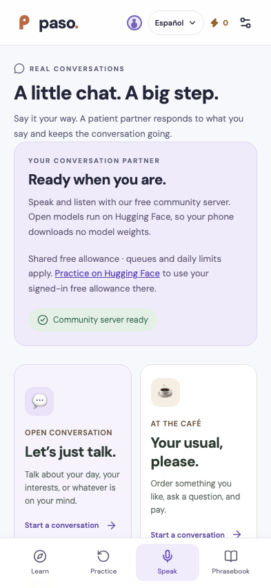

# Paso

**A little more, every day.** Open-source language learning with short lessons, spaced repetition, and speaking conversations powered by open models.

[](https://github.com/sulmatajb/paso/actions/workflows/ci.yml)
[](LICENSE)
[](LICENSE-CONTENT)

[Try the voice demo](https://huggingface.co/spaces/bessi190/paso-voice-practice) · [Setup guide](docs/setup.md) · [Contribute](CONTRIBUTING.md) · [Roadmap](ROADMAP.md)

<p align="center">
  
</p>

## What you can do

- Learn through seven exercise formats: choose, arrange, write, listen, speak, match, and dialogue.
- Resume lessons, follow prerequisites, review mistakes, and practice due cards with FSRS spaced repetition.
- Take an original Spanish placement check to choose a starting unit.
- Talk about your day or practice a café order, introductions, directions, and weekend plans.
- Record a short reply, review the transcript, and hear a generated response. **Whisper → Qwen → Kokoro** can run on a server, with no model weights downloaded to your phone.
- Choose from six synthetic voices, use 588 bundled lesson clips, and download lesson audio for offline practice.
- Keep guest progress in your browser; use account sync on a deployment with configured authentication.

| Course               | Included now                                                              |
| -------------------- | ------------------------------------------------------------------------- |
| Spanish from English | 5 beginner units, 25 lessons, 300 exercises, 190 phrases, placement check |
| French from English  | 1 starter lesson; conversation support                                    |
| English from Spanish | 1 starter lesson; conversation support                                    |

**Status: working beta.** This is an independent project with original content. It is not a complete fluency curriculum or a certified CEFR assessment. Educator review, physical-phone testing, and more courses are welcome. The [verification report](VERIFICATION.md) distinguishes real-model checks from controlled tests and documents remaining limits.

## Run it locally

Prerequisites: **Git and Node.js 22.14+** (Node 22 LTS is used in CI). No cloud account, paid API, Python, Docker, or GPU is needed for lessons and local development.

```sh
git clone https://github.com/sulmatajb/paso.git
cd paso
npm ci
npm run build
npm run db:init
npm run dev
```

Open **http://127.0.0.1:5173**. Start as a guest, or use **Account → Sign in & save progress** to exercise the local development identity. This mock sign-in only operates on loopback during development; it is not a production account provider.

Run `db:init` **once on a fresh local database**. For subsequent sessions, run `npm run dev`. See [setup and troubleshooting](docs/setup.md) for environment variables, migrations, production previews, and hosting.

### Enable speaking without downloading models

For local development, copy the example configuration and restart the dev server:

```sh
cp .dev.vars.example .dev.vars
npm run dev
```

The example points to the public [Paso voice demo](https://huggingface.co/spaces/bessi190/paso-voice-practice). Open **Speak → Conversations** and look for **Community server ready**. You can replace `HUGGINGFACE_SPACE` with your own public Space ID. No Hugging Face token goes in Paso.

The demo uses **free ZeroGPU**, with shared daily limits, queues, and possible cold starts. It may be unavailable when its allowance is exhausted. The canonical Hugging Face page lets signed-in learners use their own free allowance there; signing in elsewhere does not authenticate Paso's cross-origin API requests. There is no paid fallback. [Current provider rules](https://huggingface.co/docs/hub/spaces-zerogpu).

## Choose an inference mode

| Mode            | Setup                                                                                              | What learners download                                                       |
| --------------- | -------------------------------------------------------------------------------------------------- | ---------------------------------------------------------------------------- |
| Community Space | Set `HUGGINGFACE_SPACE`; [deploy your own free Space](self-host/huggingface/README.md) if eligible | Text and audio; no model weights                                             |
| Your own server | [Docker / existing-hardware guide](self-host/SELFHOST.md), authenticated HTTPS endpoints           | Text and audio; no model weights                                             |
| On device       | Leave server inference unset; explicitly download optional packs                                   | About 2.4 GB for chat, plus speech models; compatible WebGPU needed for chat |

All three use open models. Bundled lesson playback works independently of inference. The code does not purchase hosting or credits. Running a public service still needs donated resources, existing hardware, or a free provider allowance.

## Accounts and hosting

Guest lessons and saved progress work immediately. The included server uses **Cloudflare Workers/D1** and **Sites / Sign in with ChatGPT** for hosted identity. A clean clone contains no maintainer deployment ID, credentials, or learner data.

**Self-hosted production accounts need an authentication integration.** Outside Sites, replace `app/chatgpt-auth.ts` and the sign-in routes, or use a verified authentication gateway that strips incoming identity headers and prevents access to the unprotected Worker. Do not deploy the raw Worker as an authenticated public service. See [deployment requirements](docs/setup.md#hosting-the-full-app) and [SECURITY.md](SECURITY.md).

The public demo above demonstrates the voice server. It is not a public hosted instance of the full learning app.

## Development and checks

```sh
npm run check
npm test
npm run format:check
npm run build
# Fresh local database only; skip if already initialized:
npm run db:init
npx playwright install chromium webkit
npm run test:e2e
```

CI runs audio integrity checks, formatting, TypeScript, unit/integration tests, and browser journeys on desktop Chromium, mobile Chromium, and mobile WebKit. Standard browser CI does not download inference models or consume the community Space's allowance. [Optional real-model tests](docs/setup.md#verification) are separate.

Built with React, TypeScript, Vinext/Vite, Workers/D1, Dexie, Zod, and ts-fsrs. [Architecture and privacy](docs/architecture.md) · [Privacy policy](PRIVACY.md).

## Help build it

You do not need to write code to contribute. Review Spanish lessons, improve answer variants, test with a real phone, translate interface text, or help author a course. For code, start with a small reproducible bug or an accessibility improvement.

- [Contributor workflow and review checklist](CONTRIBUTING.md)
- [Course format, stable IDs, and migrations](docs/courses.md)
- [Reproduce and validate lesson audio](docs/speech.md)
- [Priorities and current gaps](ROADMAP.md)
- [Report a bug or suggest an improvement](https://github.com/sulmatajb/paso/issues/new/choose)

## License and independence

Application code: **[AGPL-3.0-only](LICENSE)**. Original lesson content: **[CC BY-SA 4.0](LICENSE-CONTENT)**. Model, voice, font, and runtime notices: [`public/licenses/`](public/licenses/) and the [Space notices](self-host/huggingface/THIRD_PARTY_NOTICES.md). Preserve applicable notices; model and dependency licenses also apply.

Paso is independently created and unaffiliated with Duolingo. It contains no Duolingo source code, courses, characters, or branding. “Paso” is a working name, not a trademark-clearance claim.
